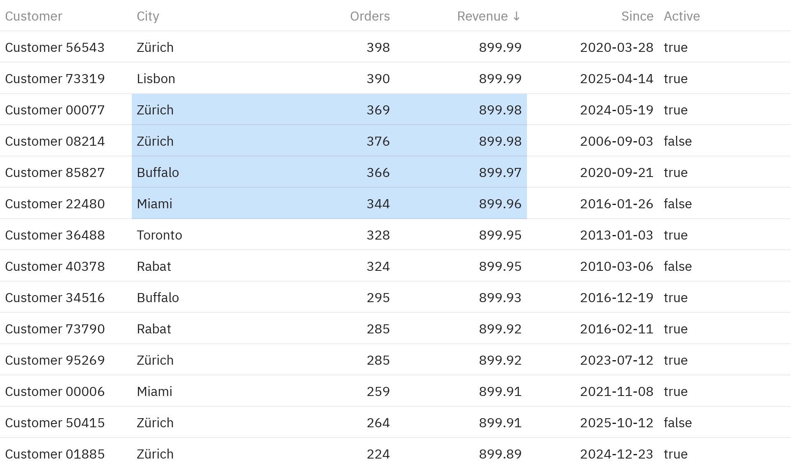
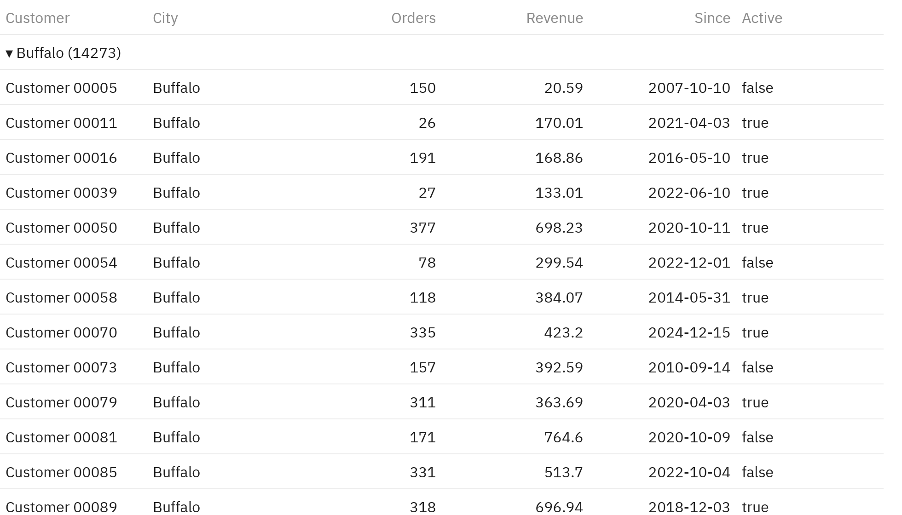

# Isonomic Grid

The data tables engine for Isonomic apps: typed columns, a query pipeline, layout, interaction, formats, and (next) the grid view.

A grid shows a **view query** (columns, filter, search, sort, grouping, aggregates, expansion) over a **data source**. The query is plain data, so a saved view, an agent's request and a fetch from a remote source are the same thing. An in-memory table is one source; the engine and remote services are others behind the same trait.





The frames above are the real renderer, run offscreen: `cargo run -p grid-gpui --example screenshot -- grid.png`.

## Layout

| Crate | Role |
|---|---|
| `grid-core` | Values, column types, the columnar table, the view query, the `DataSource` contract. |
| `grid-query` | Filter, search, sort, group, aggregate, flatten; `MemorySource`. |
| `grid-layout` | Row and column axes, pinned regions, 64-bit scrolling, hit testing. |
| `grid-interact` | Active cell and ranges, keyboard navigation, row selection, the edit log, the line being edited in a cell. |
| `grid-formats` | Delimited text in and out, typed parsing and formatting, import with type inference, paste. |
| `ui` | The component library, re-exported at one pinned revision. |
| `grid-gpui` | The view: state, one element painting the visible cells, pointer, keyboard, in-cell editing, scrolling and scrollbars. |
| `xtask` | Repository checks. |

The view crates need the component library's system dependencies to build; the headless crates do not. See `docs/status.md` for where things stand.

## Use

```rust
use grid_core::*;
use grid_query::MemorySource;

let mut source = MemorySource::new(table);
let query = ViewQuery {
    filter: Some(Filter::Is { column: ColumnId::new("age"), compare: Compare::Ge, value: Value::Int(21) }),
    sort: vec![SortKey { column: ColumnId::new("name"), direction: Direction::Ascending }],
    group_by: vec![ColumnId::new("team")],
    ..Default::default()
};
let view = source.view(&query)?;          // rows to show, in order
let page = source.fetch(&FetchRequest {   // or one window of one group
    query, group_path: vec![Value::text("core")], page: PageRequest::Range(0..50),
})?;
```

## Try it

```sh
cargo run -p grid-gpui --example playground
```

Opens the grid in a window. `cargo run --release -p grid-gpui --example frames` times the grid's share of a frame while it scrolls. Both need the component library's system dependencies; on Linux those are the usual windowing, font and Vulkan development packages.

## Develop

```sh
cargo test            # headless crates; no GPU needed
cargo test --workspace  # adds the view crate, in a headless window
cargo clippy --all-targets -- -D warnings
cargo xtask deps      # headless crates stay headless
cargo xtask sizes     # every file under 20 KB
```

The specification is in `docs/spec.md`. Working rules are in `CLAUDE.md`. Current state is in `docs/status.md`.
